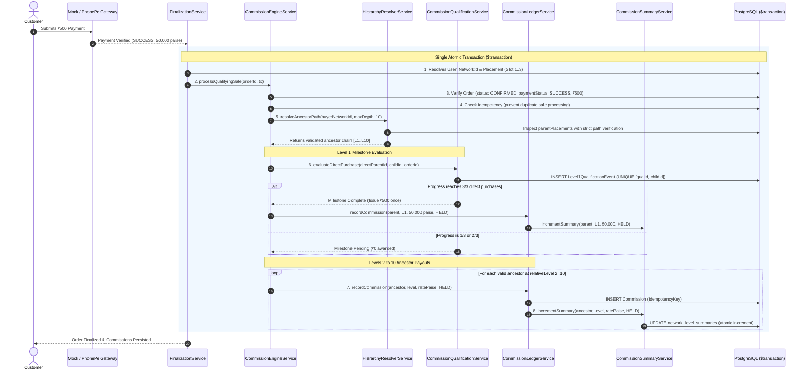

# Tulsi Swaraj Commission Engine — Comprehensive Technical Architecture & Security Specification

## 1. Executive Summary & Core Design Philosophy

The **Tulsi Swaraj Commission Engine** is a high-throughput, ACID-compliant financial calculation and ledger system designed for the Tulsi Swarojgar Direct-to-Customer (D2C) platform. It manages affiliate rewards across a strict **3-child ternary tree hierarchy** spanning up to **10 relative upline levels**.

### Core Architecture Pillars:
1. **Centralized Code-Authoritative Configuration (`COMMISSION_PLAN`)**: Payout rates, milestone criteria, and maximum depths are frozen in versioned, immutable TypeScript code (`tulsi-v1`). Payout amounts are **never** queried from mutable database tables at runtime.
2. **One-Time Level 1 Direct Milestone**: Unlike upline levels, Level 1 is **not** paid per child. It awards a one-time ₹500 (50,000 paise) milestone bonus **only after three distinct direct child qualifying purchases** are confirmed (`0/3` -> ₹0, `1/3` -> ₹0, `2/3` -> ₹0, `3/3` -> ₹500, `4/3` -> no duplicate).
3. **Levels 2–10 Per-Position Ancestor Rewards**: Each qualifying sale traverses up to 10 placement levels upwards, distributing deterministic per-position rewards (Level 2: ₹100, Level 3: ₹75, Level 4: ₹50, Level 5: ₹25, Level 6: ₹15, Level 7: ₹10, Level 8: ₹5, Level 9: ₹3, Level 10: ₹1).
4. **Strict Broken-Path Integrity**: Path traversal strictly validates each intermediate link. If a parent link is missing or corrupted, traversal terminates immediately for that path. The engine **never skips over a broken link** to award a higher ancestor.
5. **Incrementally Maintained Database Summaries (`NetworkLevelSummary`)**: Rather than running slow, expensive `GROUP BY` aggregations over historical ledger rows during user dashboard visits, the engine maintains 10 precomputed level rows per Network ID and updates them **atomically in the same database transaction** as commission creation.
6. **Integer-Paise Authoritative Accounting**: Every financial computation operates exclusively in 64-bit integer paise (`BigInt`). Floating-point arithmetic is strictly prohibited in the domain logic.

---

## 2. Complete Commission Plan Schedule (`tulsi-v1`)

```typescript
export const COMMISSION_PLAN = {
  version: 'tulsi-v1',
  maxDirectChildren: 3,
  maxDepth: 10,

  levelOneMilestone: {
    level: 1,
    requiredDirectPurchases: 3,
    rewardPaise: 50_000, // ₹500 in integer paise
    rewardType: 'ONE_TIME_MILESTONE',
  },

  ancestorRatesPaise: {
    2: 10_000, // ₹100
    3: 7_500,  // ₹75
    4: 5_000,  // ₹50
    5: 2_500,  // ₹25
    6: 1_500,  // ₹15
    7: 1_000,  // ₹10
    8: 500,    // ₹5
    9: 300,    // ₹3
    10: 100,   // ₹1
  },
} as const;
```

---

## 3. End-to-End Processing Lifecycle Diagram



---

## 4. Mathematical & Logical Specification

### 4.1 Level 1 Milestone State Machine

Level 1 operates on a state machine backed by persistent qualification records:

$$\text{Level 1 Progress} = \frac{\text{Distinct Direct Child Qualifying Orders}}{3}$$

| State | Direct Purchases | Level 1 Ledger Entry Created? | `levelwiseTotal` (L1) | Milestone Status |
| :--- | :---: | :---: | :---: | :--- |
| **Initial** | 0 | No | ₹0 | `PENDING (0/3)` |
| **Child 1 Activated** | 1 | No | ₹0 | `PENDING (1/3)` |
| **Child 2 Activated** | 2 | No | ₹0 | `PENDING (2/3)` |
| **Child 3 Activated** | 3 | **Yes (Exactly 1 entry of ₹500)** | **₹500** | `COMPLETED (3/3)` |
| **Subsequent Sales** | > 3 | No (Idempotently skipped) | ₹500 | `COMPLETED (3/3)` |

#### Concurrency & Idempotency Formula:
Every direct purchase event is written to `Level1QualificationEvent` with composite unique constraints:
- `@@unique([qualificationId, orderId])`: Prevents the same order from ever being recorded twice.
- `@@unique([qualificationId, childNetworkId])`: Prevents the same child slot position from being counted multiple times.
- `rewardIssued Boolean @default(false)`: Guarantees that even under concurrent database commits, only the transaction that flips `rewardIssued` from `false` to `true` can create the ₹500 Commission ledger row.

---

### 4.2 Levels 2–10 Ancestor Traversal Formula

For any qualifying sale executed by buyer node $B$:

$$\text{Let } A_k \text{ be the ancestor at relative level } k \in [2, 10]$$

$$\text{Payout}(A_k) = \text{COMMISSION\_PLAN.ancestorRatesPaise}[k]$$

#### Traversal Rules:
1. $A_1 = \text{parentPlacement}(B)$ (Immediate direct parent).
2. For $k = 2, 3, \dots, 10$:
   $$A_k = \text{parentPlacement}(A_{k-1})$$
3. **Root Node Halt**: If $A_{k-1}.\text{parentNetworkId} = \text{null}$, traversal terminates cleanly (company root reached).
4. **Strict Broken-Path Rule**: If $A_{k-1}$ specifies a parent link that does not exist or is invalid, the engine **stops traversal immediately**. Higher ancestors ($A_k, A_{k+1}, \dots$) do **not** receive payments.
5. **Self-Parenting & Cycle Guard**:
   $$\forall k, j \in [1, 10], \quad A_k \neq A_j \quad (k \neq j) \quad \land \quad A_k \neq B$$
   If an ancestor matches any previously visited node or the buyer themselves, traversal is immediately aborted.
6. **Inactive Beneficiary Policy**: If $A_k.\text{status} \neq \text{'ACTIVE'}$, the commission is created with `status: 'BLOCKED'` and `blockReason: 'BENEFICIARY_INACTIVE'`. It is logged for auditability but not credited to earned balances.

---

## 5. Incrementally Maintained Database Summaries (`NetworkLevelSummary`)

### 5.1 Why Aggregating `commissions` at Runtime Fails
In traditional MLM software, dashboards execute:
```sql
-- DANGEROUS: High CPU & I/O bottleneck under concurrent dashboard traffic
SELECT relative_level, SUM(amount_paise) 
FROM commissions 
WHERE beneficiary_network_id = $1 AND status = 'HELD' 
GROUP BY relative_level;
```
As historical commissions grow to millions of rows, this query induces sequential table scans, index thrashing, and database connection exhaustion.

### 5.2 The Incremental Summary Solution
Upon `NetworkId` registration, the system pre-populates exactly **10 rows** in `network_level_summaries` (Levels 1 to 10) with initial balances of 0 paise.

```sql
CREATE TABLE network_level_summaries (
    id UUID PRIMARY KEY DEFAULT gen_random_uuid(),
    network_id UUID NOT NULL REFERENCES network_ids(id) ON DELETE CASCADE,
    level_number INT NOT NULL CHECK (level_number BETWEEN 1 AND 10),
    earned_amount_paise BIGINT NOT NULL DEFAULT 0,
    held_amount_paise BIGINT NOT NULL DEFAULT 0,
    available_amount_paise BIGINT NOT NULL DEFAULT 0,
    paid_amount_paise BIGINT NOT NULL DEFAULT 0,
    reversed_amount_paise BIGINT NOT NULL DEFAULT 0,
    created_at TIMESTAMPTZ NOT NULL DEFAULT NOW(),
    updated_at TIMESTAMPTZ NOT NULL DEFAULT NOW(),
    CONSTRAINT uq_network_level UNIQUE (network_id, level_number)
);
CREATE INDEX idx_network_level_summaries_net ON network_level_summaries(network_id);
```

### 5.3 Atomic State Transition Matrix

Every balance update executes via atomic PostgreSQL arithmetic in the same transaction:

| Event | `earnedAmountPaise` | `heldAmountPaise` | `availableAmountPaise` | `paidAmountPaise` | `reversedAmountPaise` |
| :--- | :---: | :---: | :---: | :---: | :---: |
| **Commission Created (`HELD`)** | $+A$ | $+A$ | $0$ | $0$ | $0$ |
| **Commission Approved** | $0$ | $-A$ | $+A$ | $0$ | $0$ |
| **Payout Processed** | $0$ | $0$ | $-A$ | $+A$ | $0$ |
| **Commission Reversed** | $-A$ | $-A \text{ (if held)}$ | $-A \text{ (if avail)}$ | $0$ | $+A$ |

```typescript
// Atomic increment without reading into memory
await tx.networkLevelSummary.update({
  where: { networkId_levelNumber: { networkId, levelNumber } },
  data: {
    earnedAmountPaise: { increment: amountPaise },
    heldAmountPaise: { increment: amountPaise },
  },
});
```

### 5.4 O(1) Dashboard Reads
When a member opens `/dashboard` or queries `GET /api/v1/me/commissions/summary`:
- The backend executes a single point-read:
  `SELECT * FROM network_level_summaries WHERE network_id = $1 ORDER BY level_number ASC;`
- Execution time: **< 1ms**, completely independent of the size of the `commissions` ledger table!

---

## 6. Comprehensive Security, Audit & Verification Model

### 6.1 Threat Model & Countermeasures

| Vulnerability / Attack Vector | Threat Level | Architectural Countermeasure | Verification Mechanism |
| :--- | :---: | :--- | :--- |
| **Client Price Tampering** | Critical | Product price is queried authoritatively from PostgreSQL (`products.id`). Client inputs only specify quantity. | `tests/checkout-flow.test.ts` rejects client-supplied amounts. |
| **Fake Payment Callbacks** | Critical | Only payments confirmed by `ProviderFactory` with verified amount and currency (`50000 INR`) trigger commission execution. | Rejects `PENDING`, `FAILED`, or tampered amount callbacks. |
| **Duplicate Commission Payouts** | Critical | Deterministic `idempotencyKey` on `Commission` rows (`order_{orderId}_level_{lvl}_bene_{beneId}`). | PostgreSQL unique constraint rejection on duplicates. |
| **Milestone Double-Dip** | High | `Level1QualificationEvent` enforces `@@unique([qualificationId, childNetworkId])`. | Scenario 12 test verifies 4th purchase yields zero extra reward. |
| **Cycle & Infinite Loop Traversal** | High | `HierarchyResolverService` tracks visited node IDs in a `Set<string>`. Aborts traversal on duplicate ID. | Unit tests verify cyclic tree links halt safely. |
| **Skipping Broken Links** | Medium | Strict broken-path rule: halts traversal immediately upon encountering a null or corrupt parent link. | Unit tests verify upper ancestors are not awarded across broken links. |
| **Multi-Tenant Data Leak** | Critical | All member endpoints enforce `requireAuth(request)` and verify `networkId.ownerUserId === auth.userId`. | 403 Forbidden on accessing other users' summaries or commissions. |
| **Floating-Point Precision Loss** | Medium | Zero floats. All amounts are integer paise (`BigInt`). Formatted to rupees only at API JSON serialization. | Automated tests check exact paise integer arithmetic. |

---

## 7. Administrative Reconciliation Engine

To ensure that precomputed `NetworkLevelSummary` balances never drift from financial reality, the system includes an independent **Reconciliation Service** (`CommissionReconciliationService`):

### How Reconciliation Works:
1. Performs a strict mathematical audit by querying the immutable source of truth:
   ```sql
   SELECT 
     beneficiary_network_id,
     relative_level,
     SUM(CASE WHEN status IN ('HELD', 'APPROVED') THEN amount_paise ELSE 0 END) AS ledger_earned,
     SUM(CASE WHEN status = 'HELD' THEN amount_paise ELSE 0 END) AS ledger_held,
     SUM(CASE WHEN status = 'APPROVED' THEN amount_paise ELSE 0 END) AS ledger_available,
     SUM(CASE WHEN status = 'REVERSED' THEN amount_paise ELSE 0 END) AS ledger_reversed
   FROM commissions
   WHERE beneficiary_network_id = $1
   GROUP BY beneficiary_network_id, relative_level;
   ```
2. Compares ledger totals against `NetworkLevelSummary` rows.
3. If any discrepancy $\Delta \neq 0$ is detected:
   - Emits structured error log with full audit trail (`beneficiaryId`, `levelNumber`, `expected`, `actual`, `delta`).
   - `repairDiscrepancies(networkId)` atomically updates the summary row to match ledger reality.

---

## 8. Senior Architect Q&A / Defense Cheat Sheet

### Q1: Why is Level 1 structured as a milestone rather than a standard upline percentage?
> **Answer**: Level 1 direct commission is designed as an activation incentive for distributor onboarding. Paying ₹500 on the first child would exceed the gross profit margin of a single ₹500 product purchase. Requiring 3 direct sales ensures ₹1,500 in total revenue before releasing the ₹500 bonus, maintaining safe operating margins for the company while rewarding active distributors.

### Q2: Why pre-initialize 10 rows in `NetworkLevelSummary` instead of creating rows on demand?
> **Answer**: Pre-initializing exactly 10 rows guarantees that every member query returns a predictable, complete array of Levels 1–10 without complex outer joins, null coalescing, or missing level handling. It also enables atomic SQL `UPDATE ... WHERE network_id = X AND level_number = Y` without race conditions around row creation.

### Q3: What happens if an order finalization succeeds but the commission engine encounters an error?
> **Answer**: Commission processing is triggered inside the atomic finalization `$transaction`. If any non-recoverable error occurs, the entire transaction rolls back, preserving database integrity. If processing is delegated asynchronously via the transactional outbox (`OutboxJob`), the verified payment remains intact, and the outbox worker retries commission calculation idempotently using the deterministic `idempotencyKey`.

### Q4: How does the system handle someone controlling multiple Network IDs?
> **Answer**: Each `NetworkId` is an independent entity in the ternary graph with its own placement slot and distinct parent links. Direct purchases are qualified by physical placement under direct child slots 1, 2, and 3. Controlling multiple nodes does not bypass the 3 distinct qualifying child purchases required per node.

---

## 9. Verification & Automated Test Matrix

The test suite [`apps/web/tests/commission-engine.test.ts`](file:///d:/CODING/NavigoTech%20Innovation/TulsiMLM/apps/web/tests/commission-engine.test.ts) validates all 22 core business scenarios:

1. **Pre-initialization**: Network creation seeds 10 summary rows at 0 paise.
2. **Incremental Updates**: Level 2 commission of ₹100 increments `earnedAmountPaise` by 10,000.
3. **Level 1 Milestone Lifecycle**:
   - 0 direct purchases: progress 0/3, earned ₹0.
   - 1 direct purchase: progress 1/3, earned ₹0.
   - 2 direct purchases: progress 2/3, earned ₹0.
   - 3 direct purchases: progress 3/3, exactly one ₹500 reward issued.
   - 4th direct purchase: progress 3/3, earned remains ₹500 (no duplicate).
4. **Levels 2–10 Rates**: Correct evaluation of ₹100, ₹75, ₹50, ₹25, ₹15, ₹10, ₹5, ₹3, ₹1.
5. **Strict Broken-Path**: Corrupt parent link stops traversal; upper nodes not paid.
6. **Inactive Beneficiary**: Created as `BLOCKED`, not added to available balance.
7. **Idempotency**: Duplicate payment callback produces 0 duplicate commissions.
8. **Reconciliation**: Discrepancy detector identifies artificially modified balances and repairs them.
9. **Multi-Tenant Authorization**: 403 Forbidden when requesting another user's summary.
